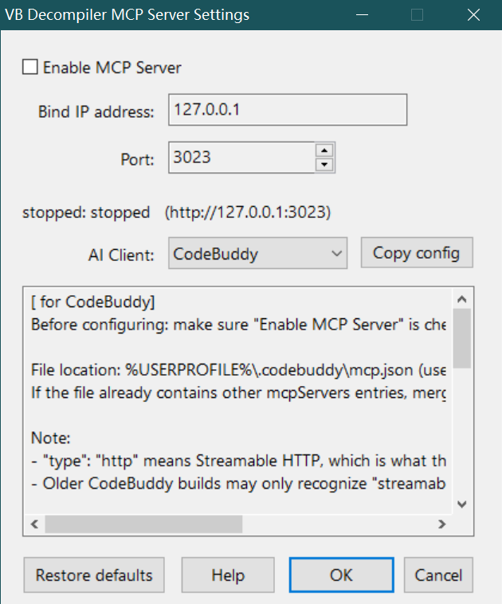

# VB Decompiler MCP Server Plugin
(https://www.vb-decompiler.org/plugins_sdk.htm)

[简体中文](README.md) | [English](README_EN.md)

C 语言实现的 [VB Decompiler](https://www.vb-decompiler.org) 插件，作为 [MCP（Model Context Protocol）](https://modelcontextprotocol.io) 服务器运行，使 AI 客户端能够通过 JSON-RPC 2.0 接口读取、修改由 VB Decompiler 反编译生成的代码与内部数据结构。



## 特性

- **27 个 MCP 工具**：覆盖项目结构（Forms、Modules、Functions）、代码读写、元数据查询；`list_*` 工具支持 `limit`/`offset` 分页。
- **中英双语界面**：菜单、设置窗体、AI 客户端接入向导、帮助文本，以及 MCP `tools/list` 工具描述与工具错误消息，均跟随 VB Decompiler 主程序语言（注册表 `CustomLanguage` = `ChineseSimplified` → 简体中文，其他/缺失 → 英文）。
- **纯 C 实现**：单线程事件驱动 + Winsock，无 C++/STL/RapidJSON 依赖。
- **零第三方库**：自实现极简 JSON 解析器、动态字符串缓冲、HTTP 服务器。
- **MCP 协议兼容**：Streamable HTTP + JSON-RPC 2.0 + SSE 占位；协议版本 2025-03-26（兼容 2024-11-05）。

## MCP 工具列表

所有工具统一加 `vb_` 前缀，避免与其他 MCP 服务器的同名工具冲突。

| 工具 | 说明 |
|---|---|
| `vb_get_project_info` | 项目元信息（路径、native/pcode、编译器类型、打包状态） |
| `vb_get_project_text` / `vb_set_project_text` | 完整项目文本读写 |
| `vb_clear_buffers` | 清空 VB Decompiler 内部缓冲 |
| `vb_list_forms` / `vb_get_form` / `vb_set_form` / `vb_rename_form` | Form CRUD |
| `vb_list_modules` / `vb_get_module` / `vb_set_module` | Module CRUD |
| `vb_list_module_functions` / `vb_get_function` / `vb_set_function` / `vb_rename_function` | Function CRUD（含反汇编视图） |
| `vb_get_sub_main` / `vb_set_sub_main` | 入口点 Sub Main |
| `vb_get_active_text` / `vb_set_active_text` / `vb_goto_line` | 当前激活窗口编辑 / 跳转行号 |
| `vb_get_active_disasm_text` / `vb_set_active_disasm_text` | 当前反汇编窗口编辑 |
| `vb_get_active_coords` | 激活视图坐标 |
| `vb_set_status` | 状态栏控制 |
| `vb_set_options` | 控制"解析栈参数"和"过程分析器"复选框 |
| `vb_list_frx_icons` | FRX 图标资源枚举 |
| `vb_update_all` | 提交所有修改并刷新 GUI |

分页：`vb_list_forms` / `vb_list_modules` / `vb_list_module_functions` / `vb_list_frx_icons` 接受 `limit`（默认 100，最大 10000）与 `offset`（默认 0），返回 `{count, total_count, offset, limit, has_more, next_offset, ...}`。

## 快速开始

### 构建

需要：Visual Studio 2019/2022 + Windows 10+。

```cmd
build.bat
```

输出：`Win32\Release\vbmcp.dll`，并尝试自动部署到 VB Decompiler 的 `Plugins` 文件夹（需管理员权限）。

### 安装

把 `vbmcp.dll` 复制到 VB Decompiler 安装目录下的 `Plugins` 文件夹（首次安装需创建）：

```
C:\Program Files\VB Decompiler\Plugins\vbmcp.dll
```

### 启动

打开 VB Decompiler 后，插件**不会自动启动 MCP 服务器**——这是刻意设计：保证服务器启动那一刻 `VBDecompilerPluginLoad` 重入已完成、Callback Engine（`g_engine`）一定有效。手动启用步骤：

1. 菜单 *Plugins → VB Decompiler MCP Server* 打开设置窗体；
2. 勾选 **启用 MCP 服务器**，点 *确定*。

默认监听 `127.0.0.1:3023`；未启用时无任何监听端口。

### 配置

通过设置窗体（菜单 *Plugins → VB Decompiler MCP Server*）修改，或直接编辑注册表：

```
HKCU\SOFTWARE\VB and VBA Program Settings\VB Decompiler\MCP
```

| 名称 | 类型 | 说明 | 默认 |
|---|---|---|---|
| `Port` | `REG_DWORD` | 监听端口（1–65535） | `3023` |
| `BindAddress` | `REG_SZ` | 绑定 IP | `127.0.0.1` |

- 字段缺失或值越界时，插件会用默认值补齐并**自动写回注册表**，方便首次安装时初始化。
- 在设置窗体改完点 *确定* → 写注册表，并立即启动/停止/重启 MCP 服务器（不需要重启 VB Decompiler）。
- 直接改注册表 → 需要点一次菜单重新打开设置窗体（或重启 VB Decompiler）让插件重读。

### 界面语言

UI 语言跟随 VB Decompiler 主程序设置，读取：

```
HKCU\SOFTWARE\VB and VBA Program Settings\VB Decompiler\Options\CustomLanguage
```

值为 `ChineseSimplified` → 简体中文；其他值/缺失 → 英文。每次打开设置窗体前会重读该值。

覆盖范围：

- Plugins 菜单项文字、设置窗体全部控件、MessageBox、帮助文本；
- AI 客户端接入向导（配置文件片段 + 操作步骤，8 个客户端各 EN/ZH 两份）；
- MCP 协议层：`tools/list` 的工具描述与工具调用的错误消息（UTF-8 JSON，与 HTTP `application/json` 一致）。

### 调试日志

设置环境变量 `VBMCP_DEBUG_LOG=1` 后，所有插件日志写入 `%TEMP%\vbmcp.log`：

```cmd
set VBMCP_DEBUG_LOG=1
"%ProgramFiles%\VB Decompiler\VB Decompiler.exe"
```

取消设置该变量（或设为 0）则禁用日志。

### 测试

```cmd
curl http://127.0.0.1:3023/health
```

返回：
```json
{"status":"ready","server":{"name":"VB Decompiler MCP Server","version":"1.0.0","protocolVersion":"2025-03-26"},"instances":[{"name":"VB Decompiler.exe","arch":"Win32","bits":32,"path":"C:\\...","pid":1234,"local":true,"state":"ready","tools_count":27}],"ready":1}
```

### MCP 客户端配置

以 CodeBuddy / Claude Desktop 为例（Streamable HTTP，键名为 `type`）：

```json
{
  "mcpServers": {
    "vbmcp": {
      "type": "http",
      "url": "http://127.0.0.1:3023"
    }
  }
}
```

设置窗体右侧的 AI 客户端下拉内置了 CodeBuddy、VS Code、Cursor、Trae、WorkBuddy、Claude Desktop、Claude Code、OpenAI Codex 的完整接入向导（随界面语言切换），点 *复制配置* 即可把带当前 URL 的配置片段写入剪贴板。

## HTTP 端点

| 方法 | 路径 | 说明 |
|---|---|---|
| POST | `/` 或 `/mcp` | JSON-RPC 2.0 入口（MCP `tools/call` 等） |
| GET  | `/` | SSE 占位（`event: endpoint` + `data: /`） |
| GET  | `/sse` | 同上（兼容旧客户端） |
| GET  | `/health` | 健康检查（含工具数、协议版本） |
| GET  | `/debug/schema` | 返回完整 tools/list schema（调试用） |
| GET  | `/debug/log` | 最近请求日志环形缓冲（调试用） |
| POST | `/debug/echo` | 原样回显 POST body（调试用） |
| OPTIONS | `*` | CORS 预检返回 204 |

## 架构

```
┌─────────────────────────────────────────┐
│ VB Decompiler 主进程（GUI）              │
│  ├─ VBDecompilerPluginLoad 入口         │
│  └─ 消息循环（窗口/WSAAsyncSelect 派发） │
│      ├─ WSAStartup（保引用计数≥1）       │
│      ├─ 隐藏消息窗口 VBMCP_SERVER_V1    │
│      │   ├─ WM_LISTEN → accept           │
│      │   ├─ WM_CLIENT → recv/flush/close │
│      │   └─ 5s 健康检查 timer            │
│      ├─ HTTP 请求解析（recv_buf）         │
│      ├─ JSON-RPC 分发                     │
│      └─ mcp_dispatch_tool                │
│           └─ g_engine(...) → VB Decompiler│
└─────────────────────────────────────────┘
```

**线程模型**：完全单线程。所有 socket IO、HTTP 解析、JSON 解析、VB Decompiler Callback Engine 调用都在 VB Decompiler 主线程（消息循环所在线程）执行，避开 Callback Engine 线程安全问题。

### 关键设计决策

1. **同步处理 HTTP 请求**：VB Decompiler 的 Callback Engine 只能在主线程调用，强制同步处理避免并发问题。MCP 请求是请求-响应的，没有并发需求。
2. **服务器不自动启动**：VB Decompiler 启动时只读配置、弹设置窗体，绝不开服务器；必须用户在设置窗体勾选启用并点"确定"。
3. **WSAStartup 一次**：插件保持 Winsock 进程级引用计数≥1，防止 VB Decompiler 其他模块 WSACleanup 时把计数归零关闭所有 socket。
4. **健康检查 timer**：每 5s 检测监听 socket 是否被外部 WSACleanup 关闭，若失效则自动重建（避免端口"凭空消失"）。
5. **SO_REUSEADDR**：允许 TIME_WAIT 时重新 bind 同一端口。
6. **双编码取串**：`vbmcp_t()` 返回 GBK（供 `MessageBoxA` / `SetDlgItemTextA` 等 ANSI 控件），`vbmcp_t_utf8()` 返回 UTF-8（供 MCP JSON-RPC / HTTP `application/json` 响应），两套并行缓存，首次访问后零开销。
7. **Memory**：所有内存用 CRT malloc/free，VB Decompiler 进程退出时统一回收。

## 第三方依赖

无。所有代码自包含：

- **HTTP 解析**：手写（约 200 行）
- **JSON 解析与序列化**：手写（约 350 行，C99）
- **动态字符串**：手写 strbuf_t（约 120 行）
- **Winsock 包装**：标准 ws2_32.dll

## 限制

- 同一进程只能运行一个 vbmcp 实例（隐藏窗口类名 `VBMCP_SERVER_V1`，避免同进程多实例冲突）
- 端口 / 绑定 IP 在设置窗体改完点 *确定* 立即生效；若直接编辑注册表，需要点一次菜单触发 `PluginLoad` 重读（或重启 VB Decompiler）
- 启用状态不持久化：每次 VB Decompiler 重启后默认不启用，需在设置窗体重新勾选
- 不实现 v3.9 以前的全部命令（部分命令在现代版本的 VB Decompiler 中可能行为不同）

## 文件结构

```
vbmcp/
├── vbmcp.sln / vbmcp.vcxproj    解决方案 + 项目
├── schema_dump.vcxproj          调试工具：离线 dump tools/list schema
├── build.bat                    构建+部署脚本
├── README.md                    中文版文档
├── README_EN.md                 英文版文档
├── src/
│   ├── vbmcp.h                  公共头（配置/常量/全局状态）
│   ├── vbmcp.def                导出函数定义
│   ├── strbuf.h / strbuf.c      动态字符串缓冲
│   ├── json.h / json.c          极简 JSON 解析
│   ├── util.c                   内存/日志/字符串工具
│   ├── config.c                 注册表配置读写（Port/BindAddress）
│   ├── lang.h / lang.c          多语言资源表（EN/ZH）+ CustomLanguage 读取
│   ├── vbdec_sdk.c              VB Decompiler Callback Engine 封装
│   ├── mcp_tools.h / mcp_tools.c  27 个 MCP 工具实现
│   ├── mcp_rpc.c                JSON-RPC 2.0 分发
│   ├── mcp_http.c               HTTP 服务器 + 事件循环
│   ├── options_dialog.c         设置窗体（双语 UI + AI 客户端接入向导）
│   └── plugin_main.c            插件入口（导出函数 + DllMain）
└── res/
    ├── vbmcp.rc                 Windows 资源（版本信息）
    └── resource.h               资源头
```

## 许可证

本项目使用 MIT 许可证。

VB Decompiler Plugin SDK 由 DotFix Software 提供，使用其原始许可证（见 plugins sdk 目录）。
