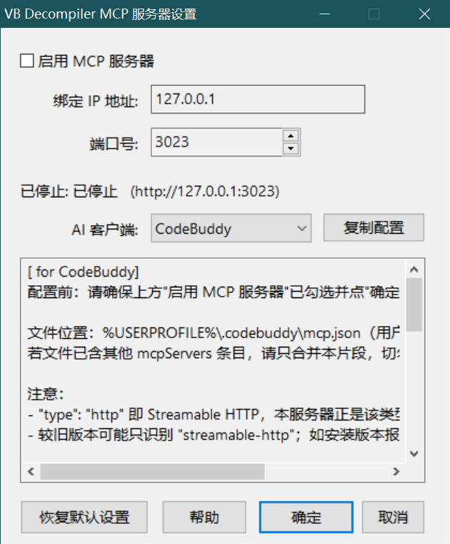
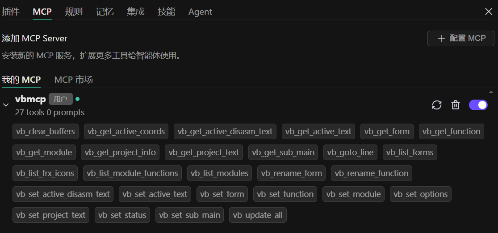

# VB Decompiler MCP Server Plugin
(https://www.vb-decompiler.org/plugins_sdk.htm)

[简体中文](README.md) | [English](README_EN.md)

A **C++17** [VB Decompiler](https://www.vb-decompiler.org) plugin that runs as an [MCP (Model Context Protocol)](https://modelcontextprotocol.io) server, letting AI clients read and modify decompiled code and internal data structures over **MCP Streamable HTTP (SSE)** + JSON-RPC 2.0.



## Features

- **MCP Streamable HTTP transport**: clients send requests with `POST`; the server pushes messages and keep-alives over an **SSE stream**. Protocol version `2025-03-26` (compatible with `2024-11-05`).
- **28 tools in two strict groups**: `vb_read_*` (13, always visible) and `vb_write_*` (15, only after you enable "Allow MCP clients to write project data").
- **Localhost by default**: binds `127.0.0.1` only — never `0.0.0.0`. LAN exposure requires an explicit opt-in plus a high-risk warning dialog.
- **Session admission control**: the first real tool call (`tools/call`) pops a confirmation dialog showing the client address; capability queries (`listTools`) never prompt.
- **Read-only by default**: `listTools` is filtered dynamically, write tools require an explicit UI switch, and `callTool` re-checks permissions (defense in depth).
- **Background network thread + UI task queue**: all socket IO runs on a dedicated background thread; every tool call is dispatched to the UI thread with timeout, cancellation and a concurrency cap — the UI is never blocked or crashed.
- **100% yyjson**: no hand-written JSON serialization anywhere; protocol errors always use the MCP standard error object.
- **Bilingual UI**: menus, settings dialog, client onboarding guides, help text, plus MCP `tools/list` descriptions and tool error messages all follow the VB Decompiler UI language.

## Security model (read this)

| Control | Default | Notes |
|---|---|---|
| Listen address | `127.0.0.1:3023` | Local-only; LAN exposure is manual + warned |
| CORS | No CORS headers at all | `Access-Control-Allow-Origin: *` is forbidden; add trusted origins explicitly (registry `CorsOrigins`) if a browser client is needed |
| Write access | Disabled (read-only) | `vb_write_*` appears only after enabling the write switch |
| Session admission | Prompt on first `tools/call` | Allow this session / deny; reset on server restart or when all clients disconnect |
| Limits | 64MB body, 200 req/s, 8 concurrent tasks | Excess → `413` / `429` + MCP standard error |

See [SECURITY.md](SECURITY.md).

## Tool list


All tools use the `vb_` prefix (avoids collisions with other MCP servers); the suffix marks read/write capability — see [docs/DEVELOPMENT.md](docs/DEVELOPMENT.md).

### Read-only group `vb_read_*`

| Tool | Description |
|---|---|
| `vb_read_project_info` | Project metadata (path, native/pcode, compiler, packed state) |
| `vb_read_project_text` | Full project text |
| `vb_read_list_forms` / `vb_read_form` | List / read forms |
| `vb_read_list_modules` / `vb_read_module` | List / read modules |
| `vb_read_list_module_functions` / `vb_read_function` | List / read functions (incl. disassembly) |
| `vb_read_sub_main` | Entry point `Sub Main` |
| `vb_read_active_text` / `vb_read_active_disasm_text` | Active window / disassembly text |
| `vb_read_active_coords` | Active view coordinates |
| `vb_read_list_frx_icons` | FRX icon resources |

### Write group `vb_write_*` (only after enabling write access)

| Tool | Description |
|---|---|
| `vb_write_project_text` | Replace the whole project text |
| `vb_write_clear_buffers` | Clear VB Decompiler internal buffers |
| `vb_write_form` / `vb_write_rename_form` | Modify / rename a form |
| `vb_write_module` / `vb_write_module_string_references` | Modify declarations / string references |
| `vb_write_function` / `vb_write_rename_function` | Modify code / rename a function |
| `vb_write_sub_main` | Modify the entry point |
| `vb_write_active_text` / `vb_write_active_disasm_text` | Edit the active window / disassembly text |
| `vb_write_goto_line` | Jump to a line |
| `vb_write_status` | Set the status bar text |
| `vb_write_options` | Toggle the "stack params" / "procedure analyzer" checkboxes |
| `vb_write_update_all` | Commit all modifications and refresh the GUI |

Pagination: `vb_read_list_forms` / `vb_read_list_modules` / `vb_read_list_module_functions` / `vb_read_list_frx_icons` accept `limit` (default 100, max 10000) and `offset` (default 0) and return `{count, total_count, offset, limit, has_more, next_offset, ...}`.

## Quick start

### Build

Requires Visual Studio 2019/2022 (C++ toolset v142) + Windows 10+.

```cmd
build.bat
```

Output: `Win32\Release\vbmcp.dll`. The project is **C++17** (`/std:c++17`, `/EHa`).

### Install

Copy `vbmcp.dll` into the VB Decompiler `Plugins` folder (create it if missing):

```
C:\Program Files\VB Decompiler\Plugins\vbmcp.dll
```

### Start

The plugin **never auto-starts** the MCP server — this is deliberate, so that `VBDecompilerPluginLoad` has already re-entered and the Callback Engine is valid.

1. Menu *Plugins → VB Decompiler MCP Server* to open the settings dialog;
2. Check **Enable MCP Server** (optionally **Allow MCP clients to write project data**) and click *OK*.

Nothing listens while disabled.

### Configuration

The settings dialog uses a **two-tab layout**:

| Tab | Content |
|---|---|
| **Server settings** | Group "Service": enable the MCP server, bind IP, port, server status, permission mode (read-only / read-write) and the hidden-by-default LAN option. Group "Permissions & security": "Allow MCP clients to write project data" plus the security notes |
| **Integration info** | Client app dropdown (8 AI clients) → auto-filled **config path**, **connection URL**, a ready-to-paste **config snippet** and **how to connect** notes, each with a copy button |
| Bottom | Restore defaults / Help / OK / Cancel (shared by both tabs) |

> The window is resizable (min 640×560, default 720×636 at 96 dpi), the UI font is
> 12pt with DPI scaling, and descriptive text uses a transparent background
> (no more text blocks with a coloured background).

Edit via the settings dialog, or directly in the registry:

```
HKCU\SOFTWARE\VB and VBA Program Settings\VB Decompiler\MCP
```

| Name | Type | Description | Default |
|---|---|---|---|
| `Port` | `REG_DWORD` | Listen port (1–65535) | `3023` |
| `BindAddress` | `REG_SZ` | Bind IP (**`127.0.0.1` recommended**) | `127.0.0.1` |
| `AllowWrite` | `REG_DWORD` | Allow MCP clients to write project data (0/1) | `0` (read-only) |
| `CorsOrigins` | `REG_SZ` | Trusted origin allowlist (comma separated; empty = no CORS headers; `*` ignored) | empty |

Missing or out-of-range values fall back to defaults and are **written back automatically**. Clicking *OK* in the dialog starts/stops/restarts the server immediately. Authorization state resets when VB Decompiler restarts.

### UI language

Follows VB Decompiler (`...\VB Decompiler\Options\CustomLanguage`): `ChineseSimplified` → Simplified Chinese; anything else/missing → English. Covers menu, settings dialog, message boxes, help, client onboarding guides, and MCP `tools/list` descriptions plus tool error messages (UTF-8 JSON).

**How i18n works**: gettext style. Every string is written as `_("English text")` in the sources; Chinese translations live in `lang_res/zh.json`, embedded into `vbmcp.dll` as `RCDATA("JSON_ZH")` at build time (no external langpack). Run `python tools/extract_i18n.py` after adding/changing text to sync the pack and produce a to-translate report; untranslated entries fall back to English at runtime.

### Debug log

```cmd
set VBMCP_LANG=en          ;; force UI language (zh/en), overrides the registry
set VBMCP_DEBUG_LOG=1     :: write %TEMP%\vbmcp.log
set VBMCP_LOG_LEVEL=3     :: 0=ERROR 1=WARN 2=INFO(default) 3=DEBUG
set VBMCP_TASK_TIMEOUT_MS=30000   :: per-task timeout in ms (1000..600000)
```

Logs contain connection info, tool names, permission decisions, error classes and durations only — **never project source or decompiled text**.

### Smoke test

```cmd
curl http://127.0.0.1:3023/health
```

```json
{"status":"ready","server":{"name":"VB Decompiler MCP Server","version":"2.0.0","protocolVersion":"2025-03-26"},"instances":[{"name":"VB Decompiler.exe","arch":"Win32","bits":32,"path":"C:\\...","pid":1234,"local":true,"state":"ready","readOnly":true,"tools_count":13}],"ready":1}
```

`readOnly:true` with `tools_count:13` means read-only mode (after enabling writes: `false` and `28`).

### Client configuration

Example for CodeBuddy / Claude Desktop (Streamable HTTP, key `type`):

```json
{
  "mcpServers": {
    "vbmcp": {
      "type": "http",
      "url": "http://127.0.0.1:3023/mcp"
    }
  }
}
```

The **Integration info** tab ships onboarding guides for CodeBuddy, VS Code, Cursor, Trae, WorkBuddy, Claude Desktop, Claude Code and OpenAI Codex: pick a client to see its config file path, connection URL, a ready-to-paste snippet and step-by-step notes, each one copyable.

## HTTP endpoints (MCP Streamable HTTP)

| Method | Path | Description |
|---|---|---|
| `POST` | `/`, `/mcp` | JSON-RPC 2.0 entry (`Accept: application/json`); `initialize` returns `Mcp-Session-Id` |
| `GET` | `/`, `/mcp`, `/sse` | Upgrade to an SSE stream (`Accept: text/event-stream`); server push + 15s heartbeat |
| `DELETE` | `/`, `/mcp` | Terminate the session (cancels in-flight tasks) |
| `OPTIONS` | `*` | CORS headers only when `Origin` matches the allowlist; otherwise none |
| `GET` | `/health` | Health check (protocol version, read-only state, visible tool count) |

Error convention: the **HTTP status code carries transport semantics** (400/404/405/406/413/415/429) while the **body is always an MCP standard error object** `{"jsonrpc":"2.0","id":null,"error":{"code":...,"message":...}}`.

| code | Meaning |
|---|---|
| `-32700` / `-32600` / `-32601` | Parse error / invalid request / method not found |
| `-32602` | Invalid params (incl. unknown tool) |
| `-32603` | Internal error (engine exception, OOM) |
| `-32001` | Permission denied (session not authorized, or `vb_write_*` in read-only mode) |
| `-32002` | Task timeout (waiting for the UI thread) |
| `-32003` | Server busy (UI task queue full) |

## Architecture

```
┌──────────────────────────────────────────────┐
│ [Network thread] dedicated background thread │
│  ├ accept / select / HTTP parsing             │
│  ├ Streamable HTTP: POST / GET(SSE) / DELETE  │
│  ├ SSE push + heartbeat                      │
│  └ UiTask dispatch ─────────────┐            │
│            ▲ result/timeout/cancel│            │
├──────────────────────────────┼────────────────┤
│ [UI thread] VB Decompiler loop│                │
│  ├ message window VBMCP_TASK_V1 (WM_TASK)    │
│  │   └ task_pump_on_ui_thread() → g_engine()  │
│  ├ settings dialog (2 tabs: server/access)   │
│  └ admission prompt (first callTool)         │
└──────────────────────────────────────────────┘
```

**Threading rules (hard constraints)**

1. The network thread only does transport work — **no UI controls, no UI objects, no Callback Engine**.
2. Every tool call is dispatched as a `UiTask` to the UI thread and executed serially there (Callback Engine is not thread-safe).
3. Each task supports a **timeout** (default 30s) and a **cancellation token** (set on client disconnect / timeout / server stop; queued tasks are dropped).
4. **Concurrency cap** `VBMCP_MAX_PENDING_TASKS = 8`: a full queue returns `429` + `-32003` immediately, so parallel big decompilations cannot freeze the UI.
5. Cross-thread state uses `std::atomic` / mutexes; log writes are serialized with a critical section.

Design details and the "add a tool" workflow: [docs/DEVELOPMENT.md](docs/DEVELOPMENT.md). Item-by-item refactor status: [docs/REFACTOR_PROGRESS.md](docs/REFACTOR_PROGRESS.md).

## Third-party dependencies

- **yyjson** (`third_party/yyjson`, MIT): the only JSON dependency; all MCP protocol payloads are built/parsed with it.
- **Winsock** (`ws2_32.lib`): transport.
- HTTP parsing and `strbuf` are self-contained; the HTTP parser implements only the subset MCP needs.

## Limitations

- One vbmcp instance per process.
- The enabled state is not persisted: after each VB Decompiler restart the server stays off until you enable it again.
- Commands older than v3.9 are not implemented (some may behave differently in modern VB Decompiler builds).
- UI tasks run serially; a task already inside an engine call cannot be interrupted (the engine call is synchronous) — cancellation applies to the queued phase and to the result write-back.

## File layout

```
vbmcp/
├── vbmcp.sln / vbmcp.vcxproj     solution + project (C++17 / Win32)
├── build.bat                     build + deploy script
├── README.md / README_EN.md      documentation (zh / en)
├── SECURITY.md                   security model and risks
├── docs/
│   ├── DEVELOPMENT.md            development guide (naming, architecture, adding tools)
│   └── REFACTOR_PROGRESS.md      refactor progress log
├── src/
│   ├── vbmcp.h                   shared header (config / constants / globals / SDK)
│   ├── vbmcp_mem.hpp             C++ RAII helpers (SocketHandle / unique_ptr / ScopeGuard)
│   ├── vbmcp.def                 exported functions
│   ├── strbuf.h / strbuf.cpp     dynamic string buffer (non-JSON text)
│   ├── util.cpp                  memory / leveled logging / string helpers
│   ├── config.cpp                registry config (Port/BindAddress/AllowWrite/CorsOrigins)
│   ├── i18n.h / i18n.cpp         gettext-style translation (_ / _A / _F / _AF) + zh.json loading
│   ├── khash.h                   string hash map used by the translation table
│   ├── vbmcp_ids.h              control/resource IDs (generated from res/vbmcp.rc)
│   ├── vbdec_sdk.cpp             Callback Engine wrapper (SEH protected)
│   ├── mcp_tools.h / mcp_tools.cpp  28 MCP tools (read/write split + permission checks)
│   ├── mcp_rpc.cpp               JSON-RPC 2.0 dispatch + session admission
│   ├── mcp_http.cpp              Streamable HTTP / SSE + network thread + UI task queue
│   ├── options_dialog.cpp        settings dialog (bilingual + write switch + LAN warning)
│   └── plugin_main.cpp           plugin entry (exports + DllMain)
├── res/vbmcp.rc                resource script: language pack + **settings dialog template**
├── lang_res/zh.json             Chinese language pack (embedded as RCDATA, version-controlled)
├── tools/extract_i18n.py        extract msgids / sync pack / to-translate report
├── third_party/yyjson/           JSON library (compiled as C)
└── res/                          Windows resources (version info)
```

## License

This project is released under the MIT license.

The VB Decompiler Plugin SDK is provided by DotFix Software under its original license (see the plugins sdk directory).